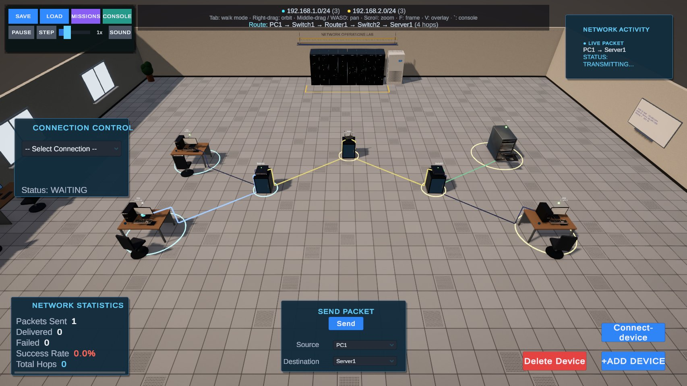
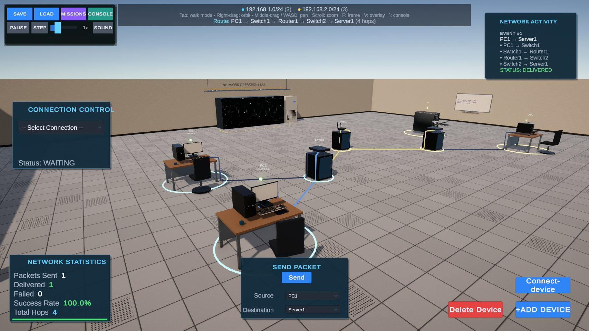
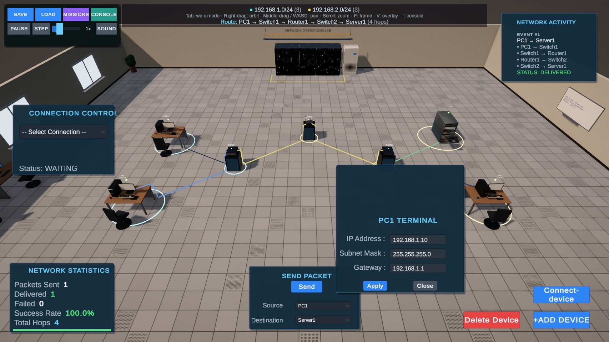
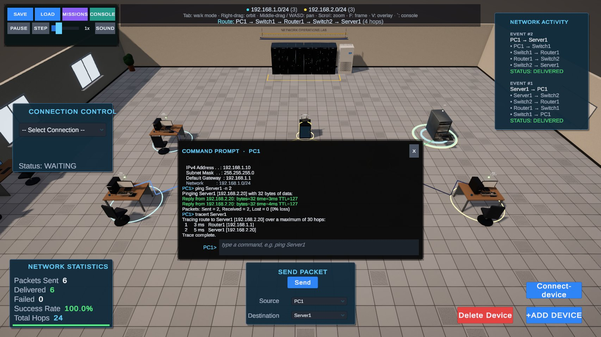
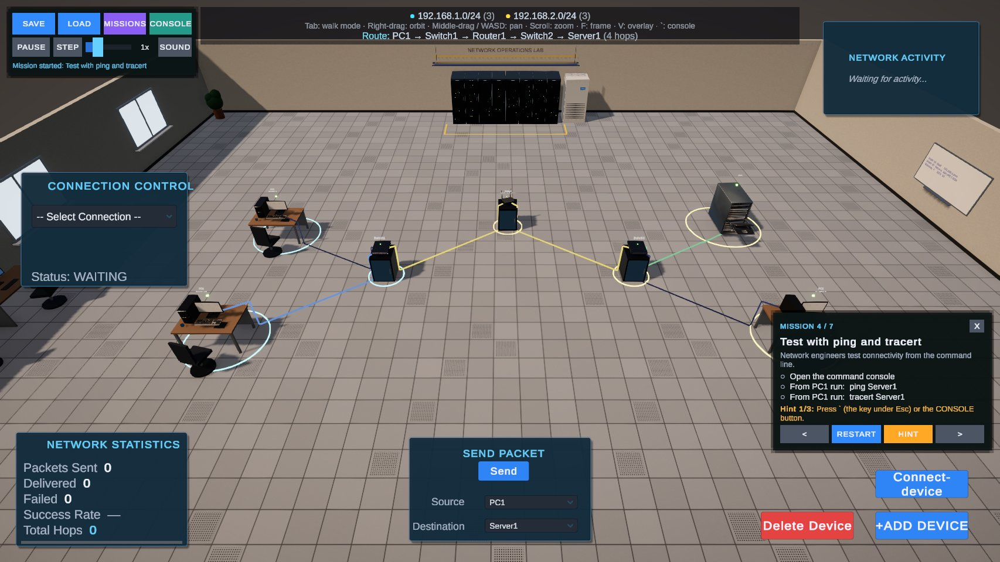
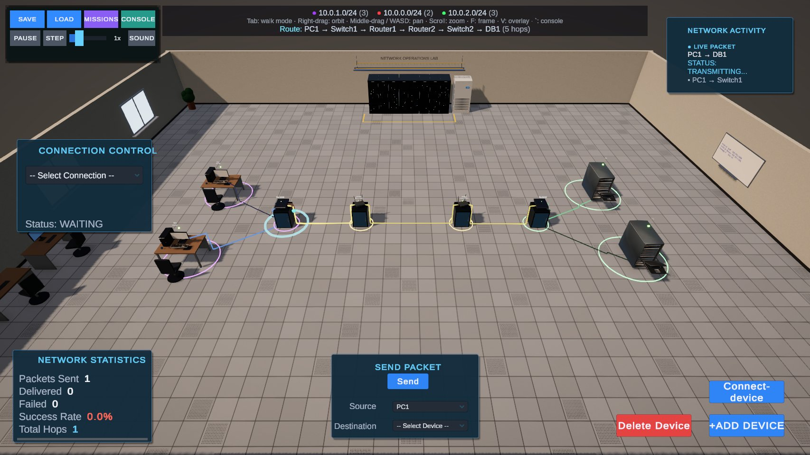
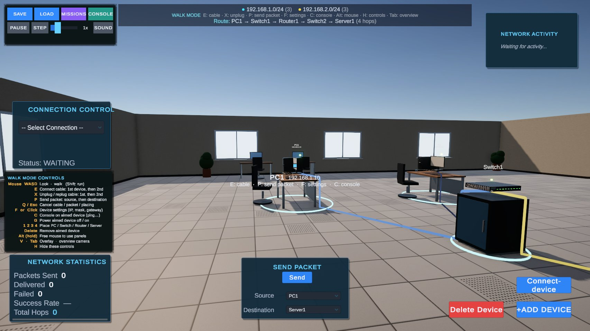
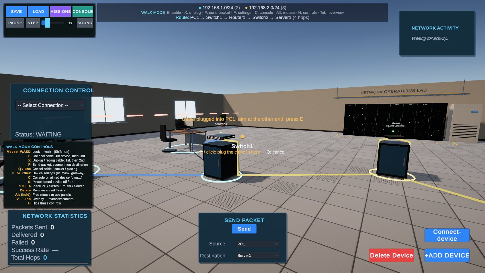
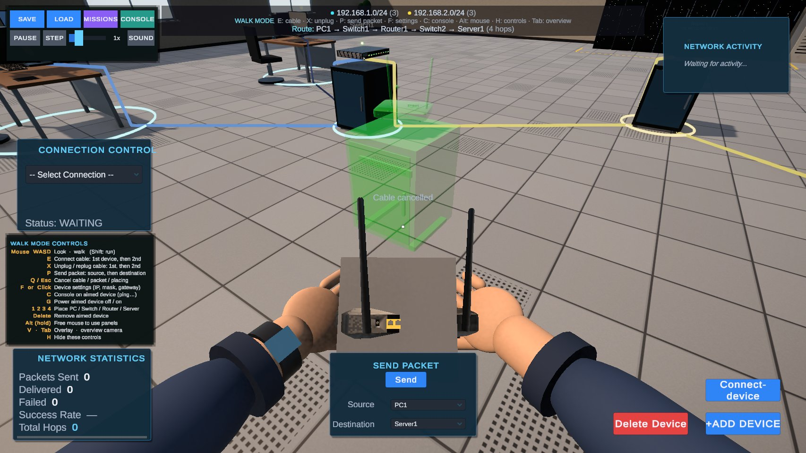

# Ar-Net: Interactive 3D Network Lab Simulator

**Build, cable, configure and troubleshoot a real-world computer network, then watch every packet travel.**

Ar-Net is a Unity 6 simulator for learning computer networking by doing. You place PCs, switches, routers and servers in a realistic network operations room, connect them with patch cables, give them IP addresses, and send packets that follow real routing rules. You can do it from a bird's-eye overview, or walk around the lab in first person with your hands holding the device you are about to install.



---

## Contents

- [Features](#features)
- [Screenshots](#screenshots)
- [Getting started](#getting-started)
- [How to use](#how-to-use)
- [Controls](#controls)
- [Command console](#command-console)
- [Guided missions](#guided-missions)
- [How routing works](#how-routing-works)
- [Project structure](#project-structure)
- [Tech stack](#tech-stack)
- [Known limitations and roadmap](#known-limitations-and-roadmap)
- [Credits](#credits)

---

## Features

### Network simulation
- **Four device types:** PC, Switch, Router and Server, each with its own 3D model.
- **IP configuration** per device: IP address, subnet mask and default gateway, with validation (invalid octets, bad masks, gateway outside the subnet, duplicate IPs).
- **Realistic routing:**
  - only switches and routers forward traffic;
  - same-subnet traffic is switched;
  - traffic between subnets goes through each side's gateway router;
  - routers can hold several interface addresses (`192.168.1.1, 192.168.2.1`).
- **Router firewall (ACLs):** `deny` / `permit` rules by source and destination network.
- **Power control:** switch any device off and watch routes through it fail.
- **Live statistics:** packets sent, delivered and failed, success rate and total hops.
- **Network Activity log** showing every hop of every packet, colour-coded (delivered, failed, alerts).

### Realistic 3D environment
- **The room:** raised-floor tiles with vent tiles, painted walls with daylight windows, a door, a whiteboard with VLAN notes and a fire extinguisher.
- **Server area:** a 42U rack row with blinking port lights, an overhead cable tray, a precision cooling unit and safety tape.
- **Office corner:** staff desks with monitors, chairs and plants.
- **Devices at real-world scale:** PCs on desks with chairs, switches and routers on network cabinets, servers as floor racks.
- **Patch cables run along the floor**, colour-coded (blue PC links, yellow uplinks, green server links). Unplugged cables lie loose on the floor.
- **Packets ride along the cables** as glowing pulses.
- **Lighting:** sunlight with soft shadows and post-processing (ACES tonemapping, bloom, vignette, SMAA).
- **Cutaway walls:** walls between the camera and the room fade out automatically, dollhouse-style.

### Visualisation
- **Subnet rings** colour-code every device by its network; switches take the colour of the LAN they serve.
- **Route preview:** choose a source and destination and the cables on the path light up. If the route is impossible, a red line shows the reason.
- **Hop, delivery and failure pulses** on the floor.
- **Legend bar** with subnets, the current route and key hints.

### Two ways to play
- **Overview mode:** orbit, pan and zoom around the lab with the mouse.
- **Walk mode (first person):**
  - walk around at eye height with mouse-look and a crosshair;
  - single-key actions for cabling, sending packets, settings, power and more;
  - your character's hands hold a miniature of the device you are placing.

### Learning tools
- **Command console:** `ipconfig`, `ping`, `tracert`, `devices`, `shutdown` / `poweron`, `acl …`
- **7 guided missions** with live checklists and hints, including troubleshooting tickets and a firewall exercise.
- **Save / Load** labs as JSON, plus ready-made example labs.
- **Simulation speed, pause and step-one-hop** for explaining things in class.
- **Procedurally generated sound effects** (no audio assets).

---

## Screenshots

| | |
|---|---|
|  **A packet travelling PC1 → Server1** through Switch1, Router1 and Switch2, with the route highlighted. |  **Close-up:** PCs on desks, switches and routers on cabinets, and patch cables along the floor. |
|  **Device terminal:** set the IP address, subnet mask and gateway. |  **Command console:** `ipconfig`, `ping` and `tracert` across the router. |
|  **Guided missions** with a live checklist and hints. |  **Data-center example:** three subnets and two routers. |
|  **Walk mode:** aim at a device to see its name, IP and actions; the controls panel lists every key. |  **Laying a cable** in walk mode: press **E** on one device, then on the other. |
|  **Placing a router** in walk mode: the hands hold the device while the green preview shows where it will go. | |

---

## Getting started

### Requirements
- **Unity 6000.5.3f1** (Unity 6). The project uses the Universal Render Pipeline.
- Packages, installed automatically by Unity: URP, Input System, uGUI / TextMesh Pro, glTFast (for the `.glb` models).

### Run it
1. Clone the repository:
   ```bash
   git clone https://github.com/abhisheknanaware/ar-net-lab.git
   ```
2. Open the folder in **Unity Hub** → *Add project from disk*, and open it with Unity 6000.5.3f1.
3. Open the scene **`Assets/Scenes/NetworkLab.unity`**.
4. Press **Play**.

> The lab environment, visualisation, toolbar, console and missions are created at runtime by `LabBootstrap`, so the scene itself stays small and easy to merge.

**Tip:** in the Game view, set *Play Focused → Play Maximized* for crisp text. If you are on a high-DPI screen, untick *Low Resolution Aspect Ratios*.

---

## How to use

### Quick start
1. Press **Play**, click **LOAD** (top-left) and choose **Two branches + router**.
2. In **Send Packet** (bottom centre) pick **Source `PC1`** and **Destination `Server1`**. The route lights up.
3. Click **Send** and watch the packet go PC1 → Switch1 → Router1 → Switch2 → Server1.

### Build your own network
1. **Add devices:** click **+ADD DEVICE**, choose a device, click the floor to place it (right-click or Esc cancels).
2. **Connect them:** click **CONNECT DEVICES**, then click two devices. Repeat for more cables.
3. **Configure IPs:** click a PC, router or server and fill in its terminal:

   | Device | IP address | Subnet mask | Gateway |
   |---|---|---|---|
   | PC1 | `192.168.1.10` | `255.255.255.0` | `192.168.1.1` |
   | Router1 | `192.168.1.1, 192.168.2.1` | `255.255.255.0` | – |
   | Server1 | `192.168.2.20` | `255.255.255.0` | `192.168.2.1` |

4. **Send traffic:** use the Send Packet panel or the console (`ping Server1`).
5. **Break and fix things:** unplug cables in **Connection Control**, power devices off, add firewall rules, and read the failure reasons.

---

## Controls

### Overview mode (default)
| Input | Action |
|---|---|
| Right-drag | Orbit the camera |
| Middle-drag / WASD | Pan |
| Scroll | Zoom |
| **F** | Frame all devices |
| **Home** | Reset view |
| **Tab** | Switch to walk mode |
| **V** | Toggle subnet overlay |
| **`** | Open the command console |
| **Delete** | Remove the device under the mouse |

### Walk mode (first person)
| Key | Action |
|---|---|
| Mouse | Look around |
| **W A S D** (Shift: run) | Walk |
| **E** | Connect a cable: aim at the 1st device, press E; aim at the 2nd, press E |
| **X** | Unplug / re-plug the cable between two devices (same two-step way) |
| **P** | Send a packet: P on the source, P on the destination |
| **Q / Esc** | Cancel the current cable / packet / placement |
| **F** or **Click** | Open the aimed device's settings |
| **C** | Open the console on the aimed device |
| **G** | Power the aimed device off / on |
| **1 2 3 4** | Pick up a PC / Switch / Router / Server, then click the floor to place it |
| **Delete** | Remove the aimed device |
| **Alt** (hold) | Free the mouse to use the panels |
| **H** | Show / hide the on-screen controls panel |
| **Tab** | Back to the overview camera |

The crosshair has **aim assist**, so you don't have to hit a device exactly, and the hint under it always tells you what the next key will do.

---

## Command console

Open with **`** (the key under Esc) or the **CONSOLE** button. Commands run on the device you last clicked or aimed at.

| Command | Description |
|---|---|
| `help` | List commands |
| `devices` | List all devices with their IP and status |
| `use <name>` | Switch the console to another device |
| `ipconfig` | Show the current device's IP, mask, gateway and network |
| `ping <ip or name> [-n count]` | Send echo requests and show replies, time and TTL |
| `tracert <ip or name>` | Show each router hop to the destination |
| `shutdown [name]` / `poweron [name]` | Power a device off / on |
| `acl deny\|permit <src> <dst>` | Add a router firewall rule (`any`, `10.0.0.5` or `192.168.1.0/24`) |
| `acl list` / `acl remove <n>` / `acl clear` | Manage the router's rules |
| `speed <0.25–4>` / `pause` | Simulation speed / pause |
| `clear` / `exit` | Clear the output / close the console |

Example:
```text
PC1> ping Server1
Pinging Server1 [192.168.2.20] with 32 bytes of data:
Reply from 192.168.2.20: bytes=32 time=3ms TTL=127
PC1> tracert Server1
  1    3 ms   Router1 [192.168.1.1]
  2    5 ms   Server1 [192.168.2.20]
Trace complete.
```

---

## Guided missions

Click **MISSIONS**, then **START**. Each mission loads its own lab, ticks off objectives live, and offers step-by-step hints.

| # | Mission | You learn |
|---|---|---|
| 1 | Build a LAN | Placing devices and cabling them through a switch |
| 2 | Give them addresses | IP addresses and subnet masks |
| 3 | Route between subnets | Router interfaces and default gateways |
| 4 | Test with ping and tracert | Command-line connectivity testing |
| 5 | Ticket #1042: PC1 can't reach the server | Troubleshooting a wrong gateway and an unplugged cable |
| 6 | Ticket #1057: PC2 keeps dropping off | Finding a duplicate IP and a powered-off server |
| 7 | Lock it down with a firewall | Writing router ACLs |

---

## How routing works

When a packet is sent, `NetworkManager.BuildRoute` decides the path like a real network would:

1. Both ends must be configured, online and have no IP conflict.
2. **Same subnet:** the packet is switched directly through switches (a breadth-first search over cables where only switches forward).
3. **Different subnets:**
   1. the source's **default gateway** must be a router in its subnet;
   2. the packet travels source → gateway router → … → the destination's gateway router → destination;
   3. routers in between may also forward.
4. Every router on the path checks its **ACL**; the first matching rule wins and unmatched traffic is permitted.
5. If anything fails, the packet is dropped and the exact reason is shown in the log, the console and the route preview.

---

## Project structure

```text
Assets/
├── Scenes/NetworkLab.unity          Main scene
├── Prefabs/                         PC, Switch, Router, Server, cable and packet prefabs
├── Models/Devices/                  3D models for the devices
└── Scripts/
    ├── Network/                     NetworkDevice, NetworkManager (routing), IpUtil, AclRule,
    │                                NetworkStatistics, SimulationClock
    ├── Connections/                 NetworkConnection (patch cables)
    ├── Packets/                     Packet (movement along cables, hop events)
    ├── Environment/                 LabEnvironment (room), DeviceFurniture, LabMaterials,
    │                                LabCameraController (orbit), FirstPersonController,
    │                                FirstPersonHands, LabViewMode (walk mode), LabBootstrap
    ├── Visualization/               NetworkVisualizer (subnet rings, route preview, pulses, legend)
    ├── Persistence/                 TopologyData, TopologyIO (save/load), TopologyLibrary (examples)
    ├── Missions/                    MissionManager (guided lessons and tickets)
    ├── Audio/                       LabSounds (procedural sound effects)
    ├── UI/                          UITheme, LabToolbar, LabConsole, DeviceConfigUI,
    │                                NetworkStatisticsUI, LabUI helpers
    └── *.cs                         Placement, connecting, deleting, packet UI, logs
docs/screenshots/                    Images used in this README
```

---

## Tech stack

- **Engine:** Unity 6 (6000.5) with the Universal Render Pipeline
- **Language:** C#
- **Input:** Unity Input System
- **UI:** uGUI + TextMesh Pro
- **Models:** FBX / glTF (glTFast)
- **Save format:** JSON (`JsonUtility`), stored in `Application.persistentDataPath/ArNetLabs/`

---

## Known limitations and roadmap

- **AR mode** (placing the lab on a real table with AR Foundation) is planned and not implemented yet.
- **Not implemented yet:** DHCP, VLANs, ARP/MAC tables and multiplayer classrooms.
- **Walk-mode hands** are built from primitives; a rigged arms model would look more realistic.
- **Run In Background:** with it disabled in Player settings, Play mode pauses when Unity loses focus.

---
